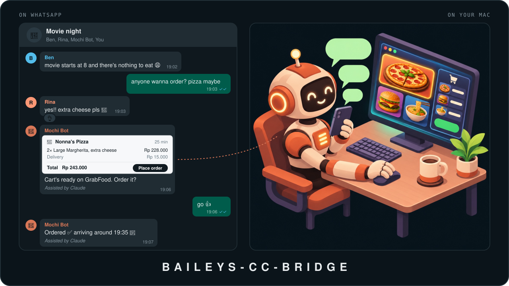
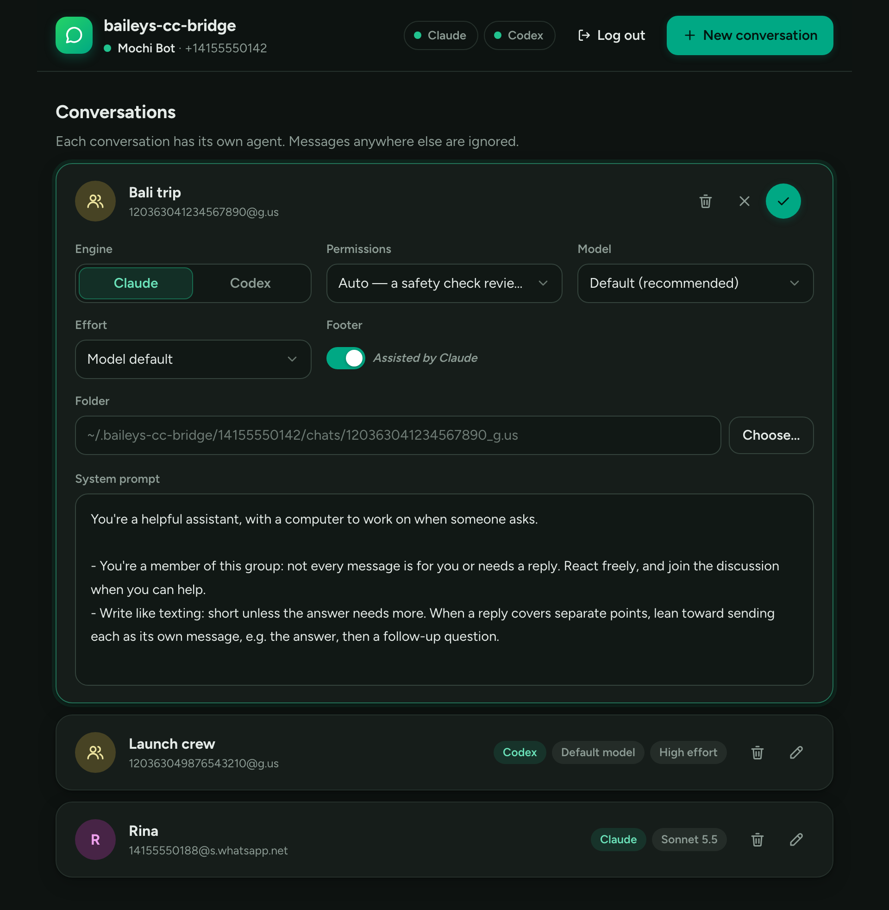
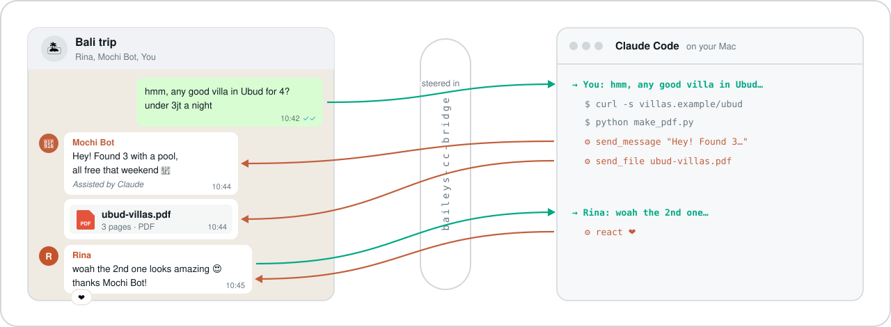

<p align="center">
  
</p>

<p align="center">
  <b>Give an AI agent a WhatsApp number and a computer. People message it like anyone else; Claude Code or Codex does the work on your Mac.</b>
</p>

<p align="center">
  
  
  
  <a href="LICENSE"></a>
</p>

Message the number directly, or add it to a group like any other member. It has your Mac to work on,
so it can run commands, read and write files and build things, then send back the result as a
message or a file.

The chat only sees what the agent decides to send: a message, a file, a reaction. Its thinking, the
commands it runs and their output stay on your Mac.

Each chat has its own session, so the agent remembers the conversation. If you message it while it
is working, it reads that too, so you can change course halfway.

## Get started

You need macOS, Node 22.18+, and Claude Code and/or Codex installed and logged in.

```sh
npm install -g baileys-cc-bridge
baileys-cc-bridge install        # runs in the background from now on, and opens its panel
```

The panel shows a QR code. Scan it from the phone whose number the agent will use (WhatsApp →
Settings → Linked devices). A spare number works best. Your own works too, but then the agent writes
as you.

Then pick the chats it listens to; it ignores every other chat. Each one gets its own engine, model,
folder and prompt:

<p align="center">
  
</p>

Before you add a group: anyone in it can ask the agent to do things on your Mac. Keep groups on
`auto` or `readonly` ([Settings](#settings)), and use `full` only where you trust everyone.

In a group it reads along and joins in when it can help, no tag needed, as in the picture at the
top. In a direct chat every message is for it, and the chat's folder can be a project of yours:

> **You:** run the tests and tell me what fails<br>
> **Mochi Bot:** 2 of 148 fail, both in `auth_test.go`. The token expiry check ignores timezones 🕐 _Assisted by Claude_<br>
> **You:** fix it and send me the diff<br>
> **Mochi Bot:** 📄 token-expiry.diff<br>
> **Mochi Bot:** all green now ✅ _Assisted by Claude_

## How it works

<p align="center">
  <picture>
    <source media="(prefers-color-scheme: dark)" srcset="assets/how-it-works.svg">
    <source media="(prefers-color-scheme: light)" srcset="assets/how-it-works-light.svg">
    
  </picture>
</p>

- The bridge is a linked device of the number, the way WhatsApp Web is, through
  [Baileys](https://github.com/WhiskeySockets/Baileys).
- Each chat you pick gets its own CLI session (`claude -p` or `codex app-server`), started by its
  first message and resumed after a restart.
- Every new message goes into that session, mid-turn too.
- The agent acts on WhatsApp through MCP tools bound to its chat. The bridge itself never writes.
- The CLIs use their own logins, so the work counts against your Claude or ChatGPT plan. The bridge
  talks only to WhatsApp and `127.0.0.1`.

## Tools

| Tool | |
|---|---|
| `send_message` | text; `reply_to` quotes, `mentions` @-mentions by number, `mention_all` the whole group |
| `send_file` | photos, videos and audio inline, anything else as a document; `voice` for voice notes |
| `send_sticker` | any image, as a sticker |
| `react` | an emoji on a message (default: the latest) |
| `chat_info` | a group's name, description and members, or who a direct chat is with |
| `schedule_job` · `list_jobs` · `cancel_job` | a task back in the chat later: once (`in 10m`, `at` a local time) or on `cron` (`0 8 * * 1-5`) |

`chat` points a tool at another chat you picked, never at one outside the list. Incoming attachments
are saved in the agent's folder, and the agent gets the path.

## Settings

The panel edits `~/.baileys-cc-bridge/<number>/config.yaml` ([example](config.example.yaml)). A change
reaches a chat's agent with the next message, once it is idle.

| Key | Default | |
|---|---|---|
| `engine` | `claude` | `claude` or `codex` |
| `model`, `effort` | the CLI's | |
| `autonomy` | `auto` | `auto`: the engine's own reviewer · `full`: no prompts, no sandbox · `readonly` |
| `workdir` | the chat's own folder | where the agent runs |
| `system_prompt` | one for groups, one for direct chats | added after the bridge's fixed instructions on how to use WhatsApp |
| `footer` | `true` | _Assisted by Claude_ (or _Codex_) under what the agent sends; handy on your own number |

## Good to know

- **Off means missed.** Messages that arrive while the bridge or the Mac is off are not replayed.
- **One connection.** `run`, `login`, `logout` and `chats` each connect to WhatsApp, and only one can
  at a time.

## Commands

| | |
|---|---|
| `install` · `uninstall` | run in the background (launchd), or stop |
| `ui` | open the panel |
| `run [-debug] [-addr] [-open]` | run in this terminal instead |
| `login [-phone N]` · `logout` | link or unlink the number from the terminal |
| `chats [filter]` | the number's JID and its groups' JIDs |

After `npm update -g baileys-cc-bridge`, run `install` again to restart on the new version. Everything
lives in `~/.baileys-cc-bridge/`: the linked device, `bridge.log`, and one folder per linked number
with its settings and its chats' sessions. The conversations themselves are the CLIs' own.

## Building from source

With Go 1.26: `go build -o ~/.local/bin/baileys-cc-bridge ./cmd/baileys-cc-bridge`. `web/` is the
panel (Vite + React; `npm run build` writes the embedded `internal/webui/dist`), `sidecar/` the
Baileys side, and `scripts/build-npm.sh` builds the binary the npm package ships.

## License

[MIT](LICENSE)
