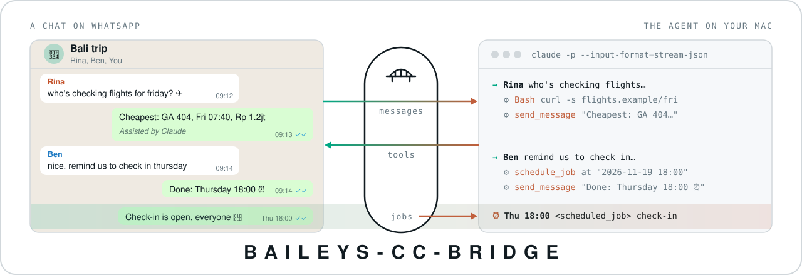

<p align="center">
  <picture>
    <source media="(prefers-color-scheme: dark)" srcset="assets/banner.svg">
    <source media="(prefers-color-scheme: light)" srcset="assets/banner-light.svg">
    
  </picture>
</p>

<p align="center">
  <b>Every message in the WhatsApp chats you pick goes to a Claude Code or Codex session on your Mac, and the agent answers from your account.</b>
</p>

<p align="center">
  
  
  
  <a href="LICENSE"></a>
</p>

baileys-cc-bridge links your Mac to your WhatsApp as a linked device, the way WhatsApp Web does. Each
chat you pick gets its own Claude Code or Codex session: every message in it goes into that session,
even mid-turn, and the agent answers with WhatsApp tools that send from your account. Every other
chat is ignored.

There is no bot number and no server. The CLIs run with their own logins, so the work counts against
your Claude or ChatGPT subscription, and the bridge itself talks only to WhatsApp and `127.0.0.1`.

The name: [Baileys](https://github.com/WhiskeySockets/Baileys) is the WhatsApp Web library it speaks
through, and cc is Claude Code. The bridge carries messages in and the agent's tool calls back out.

> **Status:** early work, macOS only. Messages that arrive while it is off are not replayed.

---

## In 30 seconds

```sh
npm install -g baileys-cc-bridge
baileys-cc-bridge install
```

The panel opens. Scan its QR code (WhatsApp → Settings → Linked devices), press **New conversation**,
pick a group, a person or "Message yourself", and choose Claude or Codex. Then, in that chat:

> **Rina:** who's checking flights for friday? ✈️<br>
> **You:** Cheapest: GA 404, Fri 07:40, Rp 1.2jt<br>
> _Assisted by Claude_

**What happened.** Rina's message reached the chat's agent as a `<message>` block. The agent worked
on your Mac and called `send_message`, and the bridge sent the answer as you, signed. The next
message in that chat goes to the same session, and so does anything the agent scheduled for later.

## How it works

1. A Node sidecar holds the WhatsApp connection with Baileys and speaks JSON lines to the Go bridge.
2. A chat's first message starts its CLI (`claude -p` in stream-json mode, or `codex app-server`);
   every later message is steered into it. After a restart the chat resumes the same conversation.
3. Each session gets an MCP server named `whatsapp`, bound to its chat. The bridge never speaks:
   what people see is a tool call the agent made.
4. A job the agent schedules comes back to its chat as a `<scheduled_job>` block, once or on a cron
   schedule.
5. `install` makes it a launchd agent: it starts at login, restarts after a crash, and serves its
   panel on `127.0.0.1:9999`.

## Install

Needs macOS, Node 22.18+, and `claude` and/or `codex` installed and logged in. The panel shows
which engines are ready, and the command that fixes one that isn't.

```sh
npm install -g baileys-cc-bridge
baileys-cc-bridge install        # runs in the background from now on, and opens its panel
```

`baileys-cc-bridge ui` opens the panel again, and `uninstall` stops the bridge. After
`npm update -g baileys-cc-bridge`, run `install` again to restart on the new version. The first
connection installs Baileys under `~/.baileys-cc-bridge/sidecar`.

From source, with Go 1.26: `go build -o ~/.local/bin/baileys-cc-bridge ./cmd/baileys-cc-bridge`.

## Tools

| Tool | |
|---|---|
| `send_message` | text; `reply_to` quotes, `mentions` @-mentions by number, `mention_all` the whole group |
| `send_file` | photos, videos and audio inline, anything else as a document; `voice` for voice notes |
| `send_sticker` | any image, as a sticker |
| `react` | an emoji on a message (default: the latest) |
| `chat_info` | a group's name, description and members, or who a direct chat is with |
| `schedule_job` · `list_jobs` · `cancel_job` | a task back in the chat later: once (`in 10m`, `at` a local time) or on `cron` (`0 8 * * 1-5`). A job due while the bridge was off runs once when it is back |

`chat` points a tool at another chat you picked, never at one outside the list. Incoming attachments
are saved in the agent's folder, and the agent gets the path.

## Config

The panel edits `~/.baileys-cc-bridge/<number>/config.yaml` ([example](config.example.yaml)). A
running bridge applies a change with the chat's next message, once its agent is idle.

| Key | Default | |
|---|---|---|
| `engine` | `claude` | `claude` or `codex` |
| `model`, `effort` | the CLI's | |
| `autonomy` | `auto` | `auto`: the engine's own reviewer · `full`: no prompts, no sandbox · `readonly` |
| `workdir` | the chat's own folder | where the agent runs |
| `system_prompt` | one for groups, one for direct chats | added after the bridge's fixed instructions on how to use WhatsApp |
| `footer` | `true` | _Assisted by Claude_ (or _Codex_) under what the agent sends |

## Limits

- **Off means missed.** Messages that arrive while the bridge or the Mac is off are not replayed.
  Scheduled jobs are: each runs once when the bridge is back.
- **It writes as you.** The agent sends from your account, and your own messages in a chat you
  picked reach it too.
- **A group can steer it.** Anyone in a group you picked can talk to an agent with a shell on your
  Mac. Keep groups on `auto` or `readonly`; use `full` where you trust everyone.
- **One connection.** `run`, `login`, `logout` and `chats` each connect to WhatsApp, and only one
  can at a time.

## Commands

| | |
|---|---|
| `install` · `uninstall` | run in the background (launchd), or stop |
| `ui` | open the panel |
| `run [-debug] [-addr] [-open]` | run in this terminal instead |
| `login [-phone N]` · `logout` | link or unlink this Mac from the terminal |
| `chats [filter]` | your JID and your groups' JIDs |

Everything lives in `~/.baileys-cc-bridge/`: the linked device, the sidecar, `bridge.log`, and one
folder per linked number with its config, its chats' conversation ids and its scheduled jobs. The
conversations themselves are the CLIs' own (`~/.claude/projects`, `~/.codex/sessions`).

## Development

`web/` is the panel (Vite + React); `npm run build` writes `internal/webui/dist`, which is committed
and embedded. `sidecar/` is the Baileys side, embedded too. `scripts/build-npm.sh` builds the binary
the npm package ships: one file for Apple Silicon and Intel.

## License

baileys-cc-bridge is released under the [MIT License](LICENSE).
